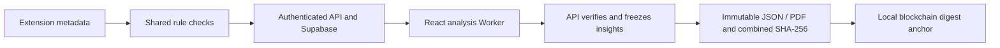

# VYLNT scan-to-blockchain pipeline

Current milestone status (2026-10-23): **experimental M6 is closed by user approval**. [Model qualification](ML_QUALIFICATION_PLAN.md) is tracked separately and remains open; no category is validated. The expanded v3 experiment failed qualification and remains developer-only. Active v2 analysis is display-only and cannot hide findings or change severity. Local M5 blockchain acceptance is complete; next product work is remaining GitHub Actions M4; Docker/deployment are excluded. See [ML build plan](ML_BUILD_PLAN.md).

The extension sends bounded metadata to the API, which validates it and recomputes pure shared rules. Supabase stores the immutable original scan. React retrieves saved scans through authenticated owner-scoped APIs; the extension does not communicate directly with a running React page.

## Automatic insights

The React Worker matches findings to target cookie/script/resource/response-policy metadata, extracts identifier-free evidence-v2 tensors and groups equivalent contexts while retaining every original finding ID. Structural snapshot order is not runtime execution or source-to-sink evidence. The first release covers the existing eight checks; behavioural detection is outside this scope.

The active v2 release is a trained eight-unit controlled LSTM under `vynlt-controlled-signal-v1`. Compatible, non-conflicting known development input variants get one calibrated, four-decimal experimental score per unique context. Issues summarize score ranges and context counts once; assessments, severity, recommendations and original evidence remain unchanged. Unfamiliar, missing or conflicting evidence receives no score. No category passed quality qualification, so this policy cannot assign contextual states or suppress findings. The reviewed-release policy remains a separate legacy path. High/critical findings remain visible. See `ml/evaluations/README.md` for measured failures and tested scope.

VYLNT developers own controlled specifications, automated oracles, training and release. Ordinary users never prepare datasets or upload a model; user verdicts/rule scores are not ground truth. The user removed mandatory independent human review from the current phase; paired-review tooling remains optional. Held-out labels cannot train the safety list or tune model/calibration/thresholds. No background training on user scans or external AI provider is used. Cookie persistence is a controlled fixture correlation, not evidence of real authentication purpose.

## Frozen report exports

**Print / PDF** retains every raw finding, severity and full evidence without generated actions or ML. **Download insights PDF/JSON** uses the separate frozen report workflow:

1. React submits the canonical analysis hash to `POST /api/scans/:id/insight-reports`.
2. The authenticated API independently rebuilds trusted assessments/templates and checks compatibility, identity and the 1 MiB combined-report bound. Stale/modified analysis returns 409; oversized content returns 413 without dropping issues.
3. It freezes the original scan and hash, grouped insights, model identity/status, input schema, decision policy and remediation-catalog versions. Mutable review notes remain separate.
4. Canonical JSON SHA-256 identifies the combined content. Equal content reuses its version; changed evidence/model/policy creates a new content identity. The original scan hash is preserved separately.
5. Local storage and Supabase migration 005 persist immutable owner-scoped versions. JSON/PDF retrieval verifies canonical integrity and trusted derivation, including rows inserted through direct user RPCs. Storage alone is not proof of API origin. Source deletion cascades to insights.

The PDF is a rendering of frozen JSON. Its displayed hash identifies the JSON content, not PDF bytes. Current and archived model identities are retained; future policy/catalog revisions must retain historical implementations or fail explicitly instead of silently changing saved reports.

## Verified status and remaining work

| Stage | Status |
| --- | --- |
| Collection, shared rules, authenticated upload | Accepted within documented M1-M3 scope |
| Automatic worker / fallback / grouped evidence | Implemented; unit, browser and built-worker checks pass |
| Controlled dataset / trained experimental LSTM / frozen evaluation | Implemented; 60 rows / four families, display-only signals and published failed qualification |
| Useful LSTM category qualification | Open; no category approved, test coverage and quality gates unmet |
| Frozen local/Supabase reports, JSON/PDF and combined SHA-256 | Implemented; migration 005 passed live two-account acceptance (14 checks, no skips/failure/cleanup failures) |
| Blockchain anchoring / on-chain verification | Local Hardhat contract, automatic durable submission and live verification implemented; disposable demonstration, not public attestation |
| Remaining GitHub Actions hosted acceptance | Follows blockchain |

See [ML build plan](ML_BUILD_PLAN.md), [developer workflow](ML_DEVELOPER_WORKFLOW.md) and [evaluation/readiness record](ML_EVALUATION.md). Docker and deployment remain excluded.

M5 anchors only the combined digest. Chain ID, contract instance/address, transaction hash and confirmation status remain separate from immutable content. Live verification recomputes exported content and validates the receipt/event/canonical block and contract lookup. A matching local anchor establishes content identity within that local instance, not scan truth, ML accuracy or independent public attestation. Scan data and user credentials stay off-chain. See [local blockchain setup and acceptance](M5_ACCEPTANCE.md); no Supabase migration or Docker is required.
