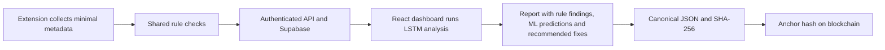

# VYNLT scan-to-blockchain pipeline

The user-confirmed target flow is:

The API/storage layer transports scans to the dashboard; the extension does not send directly to a running React page. The API recomputes rule findings from validated observations rather than trusting client scores. React performs inference on the collected metadata and existing alerts; training remains offline.

## Intended LSTM behavior

The user's 71-page report feedback clarifies the acceptance goal: produce a concise, evidence-linked assessment of meaningful issues, why they matter, what to change and how to verify the fix. Repeating per-resource rule text or merely adding actionable/contextual scores is insufficient. The model needs reviewed issue-level relevance/impact labels and representative evaluation, including false-negative analysis, before it can filter noise or rank issues reliably. Supported outputs must retain links to original evidence and disclose uncertain context. Recommendations should use reviewed guidance; original evidence remains available.

As an immediate presentation fix, Print/PDF and the server PDF now group matching rule/context/severity/fix observations, show affected counts and up to three bounded evidence samples, and print each recommendation once per group. This is deterministic compression ordered by rule severity, not ML insight or vulnerability adjudication. Synthetic LSTM scores do not suppress findings or enter this summary. All groups remain represented. Full findings remain in the workspace/JSON; combined ML-report persistence and measured prioritisation are still open.

The user clarified that the target ML module analyzes extension-collected security information with an LSTM to identify potential weaknesses and produce recommended changes in the report. The first snapshot LSTM now runs in React alongside the retained logistic comparator. It is synthetic existing-alert triage, not completion of the broader evaluated weakness-detection target.

Implement a versioned sequence of permitted security observations with explicit event order, boundaries, collection coverage and missing-data handling. A flat list of findings is not evidence of runtime behavior or source-to-sink data flow. Capture only the metadata needed for the chosen weakness categories; never persist credentials, cookie values, request bodies or page text, and sanitize evidence URLs.

Train and evaluate against independently reviewed examples for defined weakness categories, including negative/contextual cases and application-family-separated held-out data. Compare the LSTM with the existing baseline; do not assume that using an LSTM improves results. Predict only categories supported by available evidence, abstaining on unsupported/incomplete inputs. Broader weakness detection requires its own labels and evaluation; existing alert-triage metrics cannot establish detection of weaknesses missed by rules.

Run the released LSTM in the React dashboard, with model/schema identity and availability checks. Map supported predicted categories to reviewed, versioned remediation guidance explaining the evidence, suggested change and how to verify it. The model does not automatically modify the scanned website. Keep deterministic rule findings and ML predictions visibly distinct; model scores are not calibrated probabilities unless evaluation establishes that interpretation. Freeze both findings and recommendations into the final report before hashing and anchoring.

## Current implementation

Latest PDF decision: **Print / PDF** and the existing server GET export contain full finding data/severity without recommendations or ML. React's separate **Download insights PDF** posts its current model hash and per-finding outputs to the owner-authenticated API; the API checks them against the bundled model and renders trusted recomputed values with grouped recommendations and identity/provenance. A 409 asks the user to refresh after stale/modified results. This adds a verified on-demand ML export, not persisted immutable combined-report finalization. The displayed original scan hash does not cover ML insights, recommendations or PDF bytes. Ordinary automatic inference remains in React; the server repeats inference only to verify an insights export. Earlier descriptions of ML being excluded from all PDFs are historical.

| Stage | Status |
| --- | --- |
| Minimal metadata collection and shared rule checks | M1 accepted for documented Edge scope; installed-Chrome coverage remains ongoing |
| Authenticated upload, storage and dashboard retrieval | M2 development scope accepted; nine hosted two-account checks passed; production deployment remains deferred |
| React ML inference | Automatic snapshot LSTM when a saved scan opens; real PyTorch training/numeric browser runtime, model identity and rule-linked recommendations implemented; bundled weights are synthetic. Snapshot group order is not runtime data flow. Reviewed-data evaluation, broader detection and behavioral sequences remain open |
| Final report containing ML insights | Separate on-demand insights PDF implemented with server verification of React results; immutable combined JSON persistence/versioning/export remains pending |
| SHA-256 of the combined final report | Pending; existing hashes cover the original rule report only |
| Blockchain anchoring and verification | Pending; existing verification explicitly reports `anchored: false` |

## Final-report contract to implement next

Normal users do not prepare datasets or upload models. VYNLT developers own independent labels, offline training, held-out evaluation and bundled model releases. React automatically extracts features and runs the shipped model on the viewed scan. It does not automatically train on user scans or infer ground truth from its own rules. Analysis of all stored scans while React is closed would require separate background processing and is not implemented.

Keep each original scan/report immutable. Create a separately versioned final report that references its scan ID and original hash, includes the original rule findings and collection coverage, and freezes the ML outputs plus model hash, feature/ruleset versions, threshold, provenance, abstentions and experimental limitations. A changed model or analysis creates a new final report rather than replacing a previously hashed result. User review decisions remain separate unless explicitly frozen into a report version.

Persist and export this combined JSON, with PDF as a readable rendering of the same content. Canonicalize and hash the frozen JSON after ML analysis. A PDF may display that JSON hash, but that is not a hash of the PDF bytes. Validate the final-report schema and enforce ownership and size limits before saving.

Blockchain anchoring comes after finalization: store the final report's digest on-chain and retain chain ID, contract address, transaction hash and confirmation status separately. Recompute the digest from an exported report and compare it with the confirmed on-chain value for verification. Submission is not confirmation. Anchoring demonstrates a match to the anchored content; it does not prove the scan is truthful or its ML insights are correct. Keep scan data, credentials and ML inputs off-chain.

No chain, wallet, contract or funded transaction is configured or deployed by this documentation update. Begin with local contract/verification tests before any user-approved public deployment.
